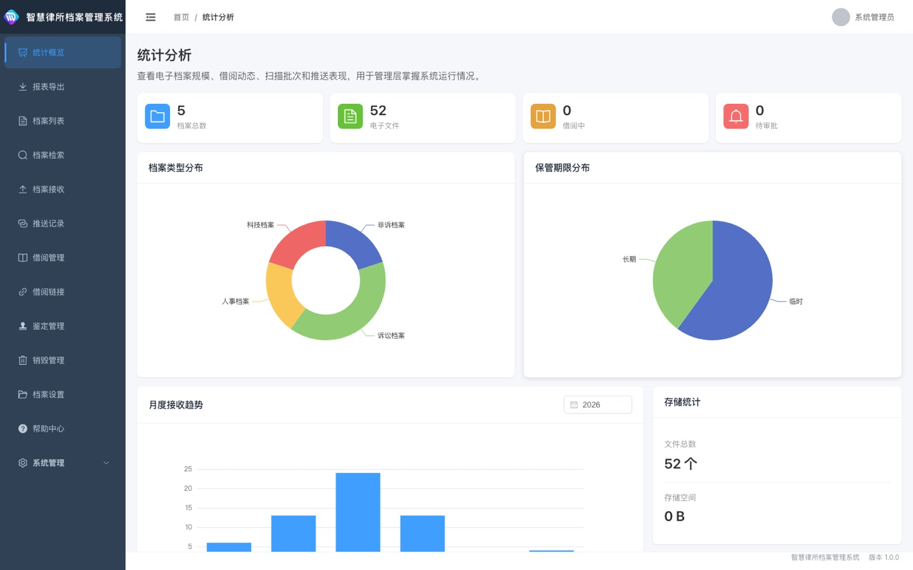
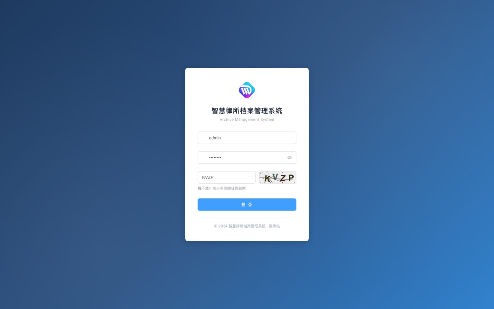
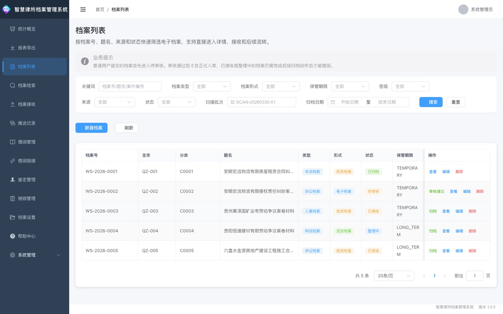
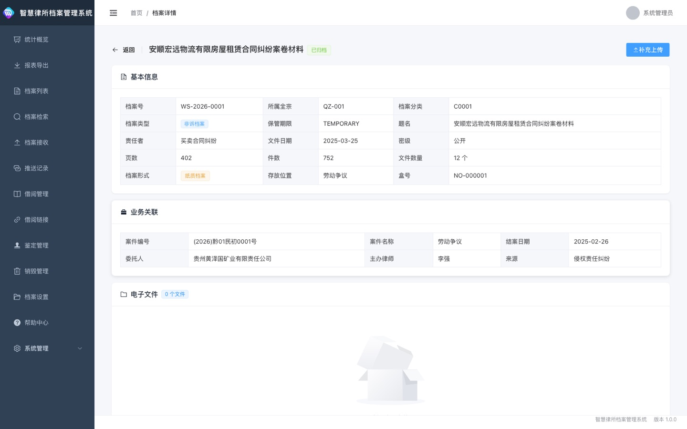
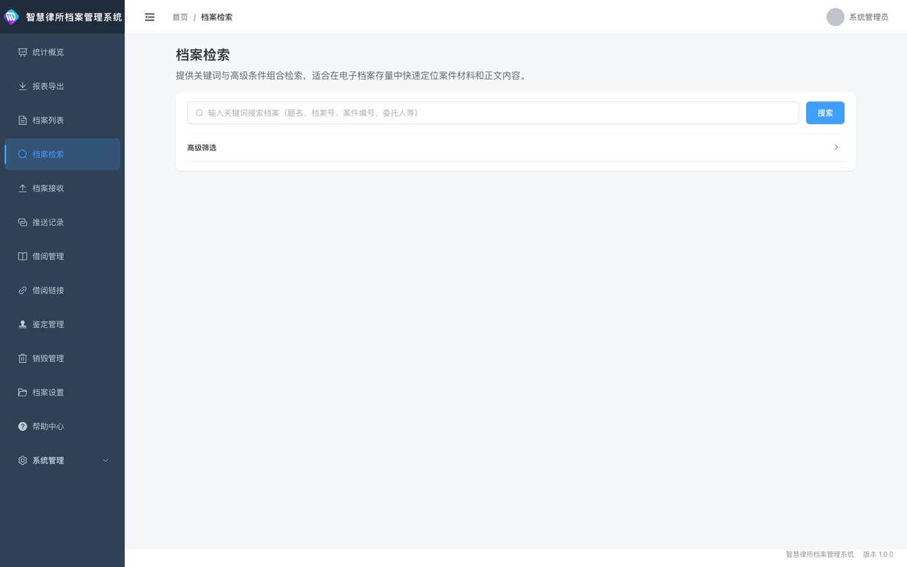
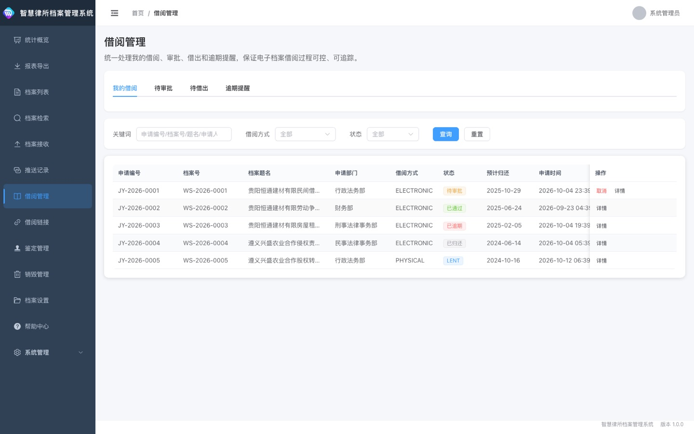
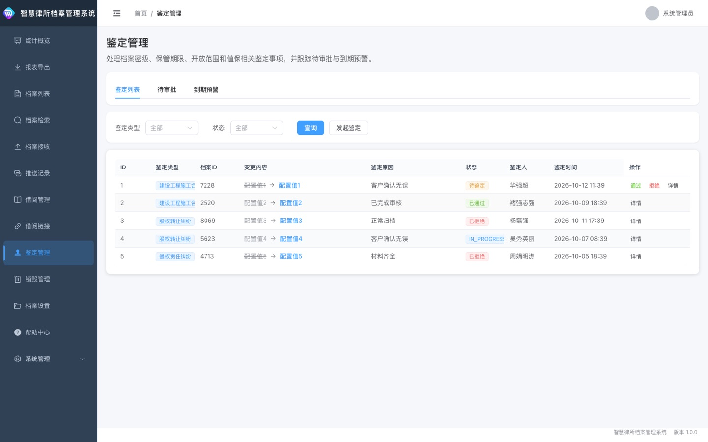
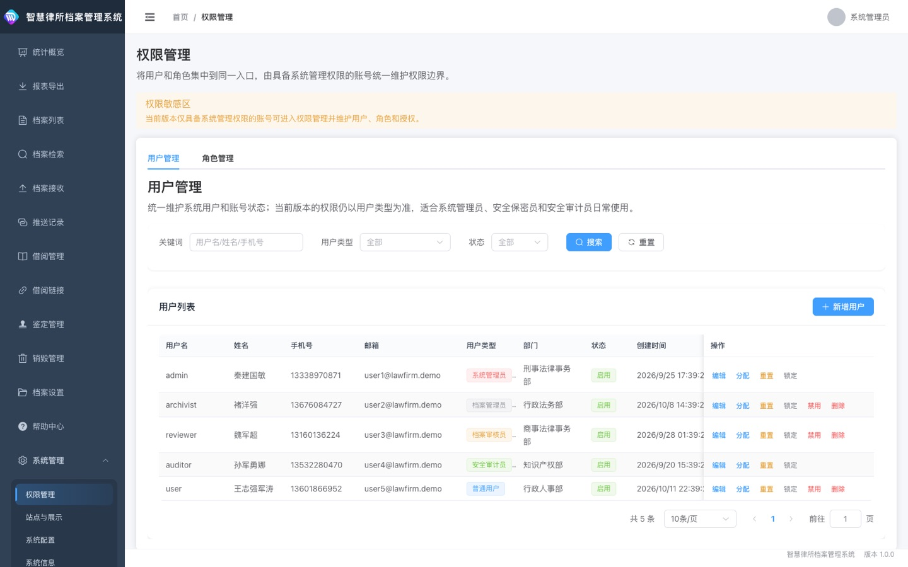

# 🗄️ 智慧律所档案管理系统 · law-firm-archive

> **面向律师事务所的电子档案全生命周期管理平台**
> 接收业务系统归档数据，打通档案接收、检索、借阅、鉴定、销毁、统计与运维管理——让每一份电子卷宗都可归档、可追溯、可审计。

<p align="center">
  <a href="https://archivedemo.zhanjunyu.com/"></a>
  
  
  
  
</p>

<p align="center">
  
</p>

> 💡 **关于在线演示**：上方演示站点为本系统的「纯前端 + 浏览器内 Mock 数据」版本，无需后端即可完整体验全部界面与交互。有意获取**包含 Spring Boot 后端与生产级数据库**的完整商业源码，请见文末「获取与授权」。

---

## ✨ 产品亮点

- **📥 统一归档入口**：通过开放接口接收业务系统的档案元数据与文件地址，自动建立可追踪的对接链路。
- **🗂️ 全生命周期管控**：从接收到检索、借阅、鉴定、销毁，每一步都有状态流转与操作留痕，符合档案管理规范。
- **📄 电子文件与业务关联**：档案可关联案件编号、案件名称、委托人、主办律师等业务字段，做到「卷档一体」。
- **🔍 多条件精准检索**：关键词配合档案类型、形式、保管期限、密级、来源、状态等组合条件快速定位卷宗。
- **📖 借阅闭环管理**：借阅申请、审批、电子借阅链接、访问记录与逾期提醒一体，借阅过程可控可查。
- **⚖️ 鉴定与销毁合规**：密级、保管期限、开放范围鉴定与到期预警；销毁申请、审批、执行全程留痕。
- **🔔 推送链路可观测**：查看档案向来源系统的推送结果、失败原因与重试情况，同步问题一目了然。
- **📊 数据看板与报表**：档案规模、借阅动态、扫描批次、推送表现可视化，支持导出 Excel 统计报表。
- **🌳 完整基础数据体系**：全宗、分类、保管期限、存放位置、来源系统集中维护。
- **🛡️ 备份恢复与操作审计**：备份目标与恢复流程统一入口，配合操作日志实现全程可审计。

---

## 🧩 功能模块

### 一、统计概览
统计分析 · 报表导出

### 二、档案管理
档案列表 · 档案详情 · 档案检索 · 档案接收 · 电子文件管理

### 三、借阅利用
借阅管理（我的借阅 / 待审批 / 待借出 / 逾期提醒）· 借阅链接

### 四、鉴定与销毁
鉴定管理（鉴定列表 / 待审批 / 到期预警）· 销毁管理（全部记录 / 待审批 / 待执行）

### 五、来源与推送
推送记录 · 来源管理 · 开放接口对接

### 六、档案设置（基础数据）
分类管理 · 全宗管理 · 存放位置 · 来源管理

### 七、系统管理
权限管理（用户 / 角色）· 站点与展示 · 系统配置 · 系统信息 · 备份恢复 · 操作日志 · 帮助中心

---

## 📸 界面一览

> 以下截图均取自真实系统界面（演示数据），直观呈现各业务板块的实际效果。

| 模块 | 界面预览 |
|---|---|
| 🔐 登录 |  |
| 🗂️ 档案列表 |  |
| 📄 档案详情 |  |
| 🔍 档案检索 |  |
| 📖 借阅管理 |  |
| ⚖️ 鉴定管理 |  |
| 📊 统计分析 |  |
| 🛡️ 权限管理 |  |

---

## 🚀 在线体验

访问 **[https://archivedemo.zhanjunyu.com/](https://archivedemo.zhanjunyu.com/)**：

| 账号 | 密码 | 角色 | 权限范围 |
|---|---|---|---|
| `admin` | `admin123` | 系统管理员 | 全部功能与系统设置 |

> 登录页已**预填账号密码**、验证码自动填充，打开后直接点击「登录」即可进入，无需任何配置。

> ⚠️ 演示站点为「前端 + 浏览器内 Mock 数据」，所见即真实界面；登录、检索、筛选等交互均已打通，数据由浏览器本地模拟生成，刷新不丢失。

---

## 🛠️ 技术架构

| 层级 | 技术选型 |
|---|---|
| 前端框架 | Vue 3 + Vite |
| UI 组件 | Element Plus |
| 状态 / 请求 | Pinia + Axios + 统一响应拦截 |
| 权限模型 | 基于角色的访问控制（RBAC）+ 动态菜单 |
| 后端（完整版） | Spring Boot 3 + MyBatis-Plus + PostgreSQL |
| 中间件 | Redis · RabbitMQ · Elasticsearch · MinIO |
| 部署形态 | Docker Compose 全栈编排；支持私有化部署 |
| 开放接口 | `/api/open/**`（来源系统 API Key 鉴权） |
| 管理接口 | `/api/**`（JWT Bearer Token 鉴权） |

---

## 📦 仓库与源码说明

| 仓库 / 地址 | 性质 | 说明 |
|---|---|---|
| [archivedemo.zhanjunyu.com](https://archivedemo.zhanjunyu.com/) | 🌐 在线演示 | 本系统的「纯前端 ＋ 浏览器内 Mock 数据」版本，无需后端即可完整体验全部界面与交互。 |
| [`JunyuZhan/law-firm-archive-demo`](https://github.com/JunyuZhan/law-firm-archive-demo) | 🌐 公开 | 本演示站点，即你正在浏览的在线 Demo（仅含静态产物与本文档截图）。 |

> 本仓库（`law-firm-archive-demo`）仅用于**产品展示与体验**，不含产品源码；如需获取**完整商业源码**（含 Spring Boot 后端、数据库脚本、Docker 部署编排与交付文档），请通过文末方式联系开发者，源码以双方约定方式交付。

---

## 🔗 相关系统

同系列产品，可搭配使用或独立部署：

| 系统 | 在线演示 | 说明 |
|---|---|---|
| 🏛️ **智慧律所管理系统** | [lawfirm.zhanjunyu.com](https://lawfirm.zhanjunyu.com/) | 律所全流程数字化管理平台——客户、案件、财务、卷宗、行政、人事、知识库、审批、报表等十二大业务板块。 |
| 🗄️ **智慧律所档案管理系统** | [archivedemo.zhanjunyu.com](https://archivedemo.zhanjunyu.com/) | 本系统——电子档案接收、检索、借阅、鉴定、销毁、统计与运维管理。 |

> 两套系统可对接联动：管理系统产生的案件与卷宗数据，可通过开放接口归档至档案管理系统，形成「业务办理 → 档案归档」的完整闭环。

---

## 👤 开发者

**junyuzhan（詹俊宇）**

- 📧 邮箱：<junyuzhan@outlook.com>
- 🐙 GitHub：[@JunyuZhan](https://github.com/JunyuZhan)
- 💼 专注企业级中后台系统与法律科技（LegalTech）产品研发

<p align="center">
  
  <br>
  <sub>📱 微信扫码添加开发者，咨询演示、报价与定制开发</sub>
</p>

---

## 💰 获取与授权

本系统提供**完整商业源码**（含 Spring Boot 后端、前端工程、数据库脚本、Docker 部署编排与交付文档），适合律所信息化、法律科技二次开发等场景。

- 📩 **商务合作 / 源码获取**：请邮件联系 <junyuzhan@outlook.com>，注明使用场景与需求。
- 💬 **微信咨询**：扫描下方二维码添加开发者微信，快速沟通演示、报价与定制需求。
- 🛠️ 支持私有化部署指导、功能定制、二次开发咨询。

<p align="center">
  
  <br>
  <sub>长按 / 扫码添加微信，备注「档案系统」优先通过</sub>
</p>

> 演示站点仅用于产品展示，不包含完整后端源码；最终交付以双方约定为准。

---

## ⚙️ 本地运行（演示版）

演示版为纯静态站点，在浏览器内提供 Mock 接口，本地预览需通过 `localhost` 访问：

```bash
# 在仓库根目录启动任意静态服务器
python3 -m http.server 8080
# 浏览器打开
open http://localhost:8080
```

---

## 📄 版权与免责

本仓库演示站点由前端构建产物与浏览器内 Mock 适配层组成，版权归开发者 **junyuzhan（詹俊宇）** 所有。未经授权不得用于商业转售；如需商用，请通过上述渠道获取正式授权。

演示数据（档案、借阅、用户、金额等）均为虚构，与任何真实客户无关。
